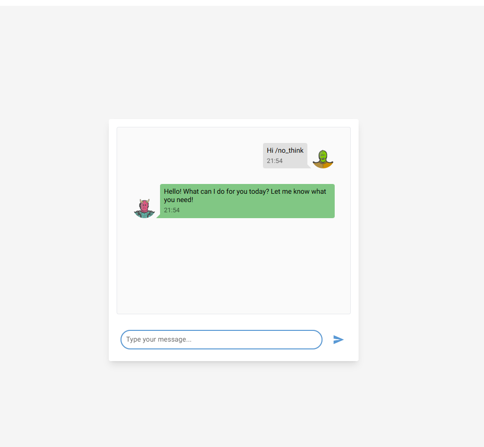

# Generative AI Project Template


A FastAPI backend and NiceGUI frontend for chat, document extraction and RAG, with local Ollama
or cloud models through LiteLLM. Includes uv workspace tooling, tests, evaluation tools,
Docker Compose and GitHub releases.



## Get started

Requires Make, Bash, Git and uv. uv provisions Python 3.14.8.

```bash
git clone https://github.com/AmineDjeghri/generative-ai-project-template.git
cd generative-ai-project-template
make install-dev
cp .env.example .env
```

Configure `INFERENCE_*` and `EMBEDDINGS_*` in `.env` for your model provider, then start the app:

```bash
make run-app
```

Open the frontend at <http://localhost:8080> or backend API docs at <http://localhost:8000/docs>.
For local Ollama, install it with `make install-ollama`, then use `make run-app-with-ollama`
to prepare the models and start both services.

## Other ways to run

| Command                                  | Use                                                            |
|------------------------------------------|----------------------------------------------------------------|
| `make docker-compose`                    | Backend, frontend and Ollama in containers; Compose 2.24+      |
| `make docker-compose-cuda`               | Same stack with GPU access for Ollama; NVIDIA drivers required |
| `make docker-compose-rebuild`            | Rebuild containers after source changes                        |
| `make run-backend` / `make run-frontend` | Start either application separately                            |

Python PyTorch extras are optional for model development; Ollama inference runs outside Python.
See [Setup](docs/developer/1.setup.md) for provider URLs, CUDA variants and timeouts.

## Develop

Install Git hooks once with `make pre-commit-install`.
For offline work, run `make test-local`; before a PR, configure the integration services and run
`make check`. That includes live LLM/Ollama/API tests; [Testing](docs/developer/4.testing.md)
lists the requirements. `make help` lists all targets.

| Task                                 | Guide                                                                                                                                     |
|--------------------------------------|-------------------------------------------------------------------------------------------------------------------------------------------|
| Install, run or configure providers  | [Setup](docs/developer/1.setup.md)                                                                                                        |
| Add routes, settings or dependencies | [Project structure](docs/developer/2.project-structure.md)                                                                                |
| Prepare a contribution               | [Contributing](CONTRIBUTING.md) and [conventions](docs/developer/3.conventions.md)                                                        |
| Run tests                            | [Testing](docs/developer/4.testing.md)                                                                                                    |
| Publish or retry a release           | [Release](docs/developer/5.release.md)                                                                                                    |
| Start your own project               | [Use this template](https://github.com/aminedjeghri/generative-ai-project-template/generate) and [rename guide](docs/developer/6.fork.md) |

Preview documentation with `make deploy-doc-local`.
