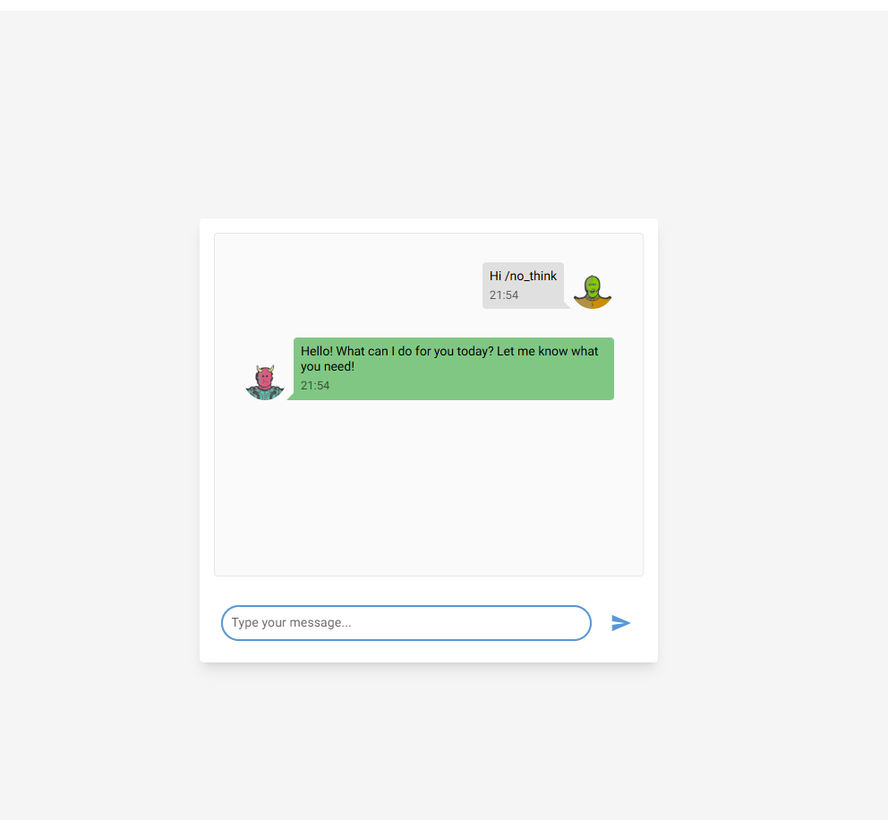

<h1>Generative AI Project Template</h1>

[](https://www.python.org/downloads/release/python-3148/)
[](https://www.debian.org/)
[](#)

[](#)
[](https://pytorch.org/get-started/locally/)
[](#)

[](#)
[](#)

[](https://github.com/charliermarsh/ruff)
[](#)
[]()
[](#)
[](#)

Template for a new AI Cloud project.

Click on [<kbd>Use this template</kbd>](https://github.com/aminedjeghri/generative-ai-project-template/generate) to start your own project!


This project is a generative ai template. It contains the following features: LLMs, information extraction, chat, rag & evaluation.
It uses LLMs(local or cloud), NiceGUI (frontend) & FastAPI (backend) & Promptfoo as an evaluation and redteam framework for your AI system.

| Test LLM                                                                         |
|----------------------------------------------------------------------------------|
|  |

**Engineering tools:**

- [x] Use UV to manage packages in a workspace (`frontend` and `backend`).
- [x] pre-commit hooks: use ``ruff`` to ensure the code quality & ``detect-secrets`` to scan the secrets in the code.
- [x] Logging using loguru (with colors)
- [x] Pytest for unit tests
- [x] Dockerized project (Dockerfile & docker-compose).
- [x] NiceGUI (frontend) & FastAPI (backend)
- [x] Make commands to handle everything for you: install, run, test

**AI tools:**

- [x] LLM running locally with Ollama or  in the cloud with any LLM provider (LiteLLM)
- [x] Information extraction and Question answering from documents
- [x] Chat to test the AI system
- [x] Efficient async code using asyncio.
- [x] AI Evaluation framework: using Promptfoo, Ragas & more...

**CI/CD & Maintenance tools:**

- [x] CI/CD pipelines: ``.github/workflows`` for GitHub (Testing the AI system, local models with Ollama and the dockerized app)
- [x] Local CI/CD pipelines: GitHub Actions using ``github act``
- [x] GitHub Actions for deploying to GitHub Pages with properdocs gh-deploy
- [x] Renovate ``.github/renovate.json`` for automatic dependency and security updates
- [x] Issues & PRs templates

**Documentation tools:**

- [x] Wiki creation and setup of documentation website using properdocs (mkdocs-material)
- [x] GitHub Pages deployment using mkdocs gh-deploy plugin

## 1. Getting started

This project is a monorepo containing two main packages:

- `frontend`: A [NiceGUI](https://nicegui.io/) application.
- `backend`: A [FastAPI](https://fastapi.tiangolo.com/) application that serves the AI models and business logic.

The project uses `uv` as a package manager and is configured as a workspace, so dependencies for both packages can be installed with a single command.

### Project Structure

- `frontend/`: The NiceGUI frontend application.
    - `pyproject.toml`: Frontend-specific dependencies.
    - `src/`: Source code for the frontend.
- `backend/`: The FastAPI backend application.
    - `pyproject.toml`: Backend-specific dependencies.
    - `src/`: Source code for the backend.
- `.github/`: GitHub-specific files.
    - `workflows/`: GitHub Actions CI/CD pipelines.
    - `dependabot.yml`: Dependabot configuration for dependency updates.
- `assets/`: Static assets like images.
- `scripts/`: Utility scripts.
- `tests/`: Pytest unit and integration tests.
- `.env.example`: Example environment variables. Create a `.env` from this.
- `Dockerfile`: To build the application container.
- `docker-compose.yml`: To run services like `frontend`, `backend`, and `ollama`.
- `.gitlab-ci.yml`: GitLab CI configuration file.
- `Makefile`: Main entry point that includes modular makefiles.
- `makefiles/`: Modular makefile includes organized by purpose.
    - `common.mk`: Shared variables (colors, UV path, Ollama models).
    - `install.mk`: Installation targets (uv, dependencies, Ollama).
    - `dev.mk`: Development targets (run frontend/backend, pre-commit).
    - `test.mk`: Testing targets (pytest, Ollama tests).
    - `build.mk`: Build and Docker targets.
    - `ci.mk`: CI/CD targets (GitHub Actions locally).
    - `clean.mk`: Cleanup targets (cache management).
- `pyproject.toml`: Defines `uv` workspace and shared dependencies.
- `uv.lock`: Lock file for `uv` package manager.
- `.pre-commit-config.yaml`: Configuration for pre-commit hooks.
- `properdocs.yml`: Configuration for the documentation site.
- `README.md`, `CONTRIBUTING.md`, `CODE_OF_CONDUCT.md`, `LICENSE`: Project documentation.

### 1.1. Local Prerequisites

- `make` command
- git clone the repository
- Create a ``.env`` file *(take a look at the ``.env.example`` file)*

### 1.2 ⚙️ Steps for Installation

This project uses a `Makefile` to simplify the installation and execution process.

#### Local Installation

1. **For the default environment (including macOS)**
   To install all dependencies for both `frontend` and `backend` without installing PyTorch, run:

   ```bash
   make install-dev
   ```

2. **For optional PyTorch development**
   If your own Python code needs PyTorch, use `make install-dev-cpu`, or for NVIDIA CUDA:

   ```bash
   make install-dev-cuda
   ```

   Ollama performs chat inference in a separate process. These optional PyTorch installs do not accelerate Ollama; use the GPU Compose override for containerized Ollama.

#### Using Docker

The project can be fully containerized using Docker. This is the recommended way to run the application as it handles all services and networks.

- `docker-compose.yml` defines the services; `docker-compose-cuda.yml` adds GPU access to Ollama. Docker Compose 2.24 or newer is required. Images install locked dependencies at build time; run the rebuild target after changing code.
- To run the entire application stack using Docker Compose with CPU support:

  ```bash
  make docker-compose
  ```

- To run with CUDA support, make sure you have a GPU and the necessary drivers installed. Follow this [guide](https://docs.ollama.com/docker#nvidia-gpu) to set it up. Then run:

  ```bash
  make docker-compose-cuda
  ```

- To rebuild and run (useful after code changes):

  ```bash
  # CPU
  make docker-compose-rebuild
  # CUDA
  make docker-compose-cuda-rebuild
  ```

#### Using Local vs. Cloud LLMs

- **Local model (Ollama)**:
    - Install Ollama: `make install-ollama`
    - Ensure Ollama is running (`make run-ollama` can help).
    - Set your `.env` file to point to the local Ollama endpoint (copy and paste from the `.env.example` file).
    - Download a model: `make download-ollama-models`
    - Test the connection: `make test-smoke-ollama`
    - Test the connection: `make test-integration-llm`
- **Cloud model (OpenAI, Anthropic, etc.)**:
    - Update your `.env` file with the correct API keys and model names, following the [LiteLLM naming convention](https://docs.litellm.ai/docs/providers).
    - Test the connection: `make test-integration-llm`

#### Running the Application

Once installed (either locally or via Docker), you can run the services.

- **Run the application:** `make run-app` starts the frontend and backend using the model provider configured in `.env`.
- **Include local Ollama:** `make run-app-with-ollama` starts or reuses Ollama, downloads missing models, then starts the application. Install Ollama once with `make install-ollama`.

- **Run Services Individually:**
    - **Run Backend:** `make run-backend`
    - **Run Frontend:** `make run-frontend`

You can then access:

- Frontend (NiceGUI): [http://localhost:8080](http://localhost:8080) (or the configured port)
- Backend (FastAPI): [http://localhost:8000](http://localhost:8000) (or the configured port). Docs [http://localhost:8000/docs](http://localhost:8000/docs)

### 1.3 ⚙️ Steps for Installation (Contributors and maintainers)

Developer guide: [1. Setup](docs/developer/1.setup.md), [2. Project structure](docs/developer/2.project-structure.md), [3. Conventions](docs/developer/3.conventions.md), [4. Testing](docs/developer/4.testing.md), [5. Release](docs/developer/5.release.md), [6. Start from this template](docs/developer/6.fork.md).

## 2. Makefile Commands

The project uses a modular Makefile structure. Run `make help` to see all available commands.

### Installation Commands

| Command                         | Description                                         |
|---------------------------------|-----------------------------------------------------|
| `make install-uv`               | Install uv package manager                          |
| `make install-dev`              | Install application, dev and docs dependencies      |
| `make install-dev-cpu`          | Install dev dependencies plus optional CPU PyTorch  |
| `make install-dev-cuda`         | Install dev dependencies plus optional CUDA PyTorch |
| `make install-frontend`         | Install frontend dependencies only                  |
| `make install-backend`          | Install backend dependencies without PyTorch        |
| `make install-backend-cuda`     | Install backend plus optional CUDA PyTorch          |
| `make install-ollama`           | Install Ollama                                      |
| `make download-ollama-models`   | Download Ollama models                              |

### Development Commands

| Command                     | Description                                           |
| --------------------------- | ----------------------------------------------------- |
| `make run-frontend`         | Run the frontend (NiceGUI)                            |
| `make run-backend`          | Run the backend (FastAPI)                             |
| `make run-frontend-backend` | Run frontend and backend together                     |
| `make run-app`              | Run frontend and backend with the configured provider |
| `make run-app-with-ollama`  | Prepare local Ollama models and run the application   |
| `make run-ollama`           | Run Ollama server                                     |
| `make chat-ollama`          | Chat with Ollama model                                |
| `make pre-commit`           | Run pre-commit on all files                           |

### Testing Commands

| Command                       | Description                                               |
|-------------------------------|-----------------------------------------------------------|
| `make test-all`               | All software suites, including real-service integration   |
| `make test-integration`       | Real LLM/Ollama/API tests, parallel (`N=4`)               |
| `make test-smoke-ollama`      | Test Ollama connection                                    |
| `make test-integration-llm`   | Test LLM inference                                        |

### Build & Docker Commands

| Command                       | Description                          |
|-------------------------------|--------------------------------------|
| `make docker-compose`         | Run docker-compose                   |
| `make docker-compose-cuda`    | Run docker-compose with CUDA support |
| `make docker-compose-rebuild` | Run docker-compose with rebuild      |
| `make deploy-doc-local`       | Deploy documentation locally         |
| `make deploy-doc-gh`          | Deploy documentation to GitHub Pages |

### CI/CD Commands

| Command               | Description                                  |
|-----------------------|----------------------------------------------|
| `make install-act`    | Install GitHub Actions act for local testing |
| `make act`            | Run GitHub Actions locally                   |
| `make clear_ci_cache` | Clear GitHub and GitLab CI local caches      |

### Release Commands

| Command                | Description                                                                                             |
|------------------------|---------------------------------------------------------------------------------------------------------|
| `make release-version` | Build all packages, then version, changelog, commit, tag and GitHub release                             |
| `make release-assets`  | Attach the backend and frontend wheels and sdists to the GitHub release                                 |
| `make release`         | Guarded release and complete artifact upload; safe to retry ([5. Release](docs/developer/5.release.md)) |

### Cleanup Commands

| Command               | Description                    |
|-----------------------|--------------------------------|
| `make prune-uv`       | Remove unused uv cache entries |
| `make clean-uv-cache` | Remove all uv cache entries    |

## 3. Contributing

Check the [CONTRIBUTING.md](CONTRIBUTING.md) file for more information.

## Comprehensive software validation

`make test-all` is the required comprehensive software check for users, developers and CI.
It includes every existing self-contained and real-service integration suite. Configure the services
and dedicated test credentials in [the testing guide](docs/developer/4.testing.md) before running it. A focused `make test-local` pass does not
establish full validation. Missing services or skipped integration must be reported as incomplete.
Coverage and artifact/runtime checks remain explicit alongside this command.
