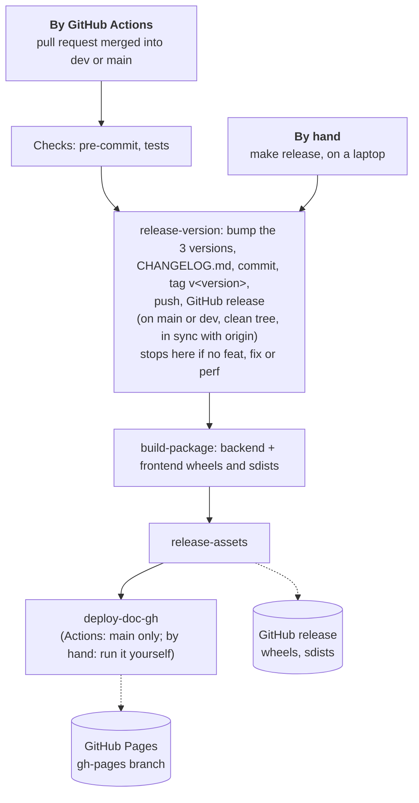
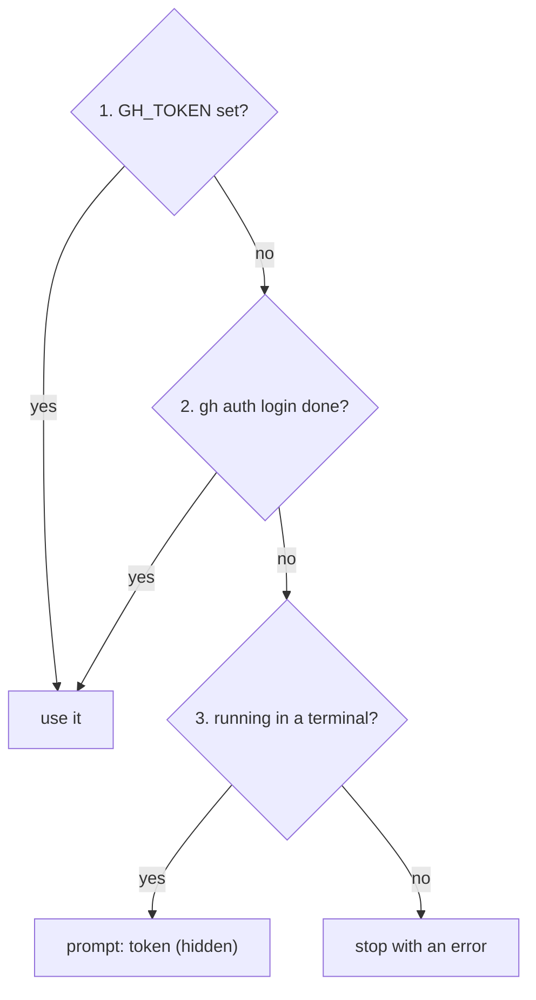

# 5. Release

Publish a version to GitHub: by hand from a laptop, or by GitHub Actions after a merge. Both run
the same `make` targets.

## Overview



## What a release publishes

| What | Where | By hand | By GitHub Actions |
| --- | --- | --- | --- |
| version in `pyproject.toml`, `backend/pyproject.toml`, `frontend/pyproject.toml` (bumped together), `CHANGELOG.md`, tag `v<version>`, GitHub release | this repository | `make release-version` | merge to `main` (stable) or `dev` (`-rc.<n>`) |
| `genai_template_backend` and `genai_template_frontend` wheels + sdists on the GitHub release | GitHub releases | `make build-package release-assets` | `main` and `dev` |
| documentation site | GitHub Pages (`gh-pages` branch) | `make deploy-doc-gh` | `main` only |

The version comes from the commit messages since the last tag
([3. Conventions](3.conventions.md#commit-convention)): no `feat`/`fix`/`perf`, no release.

| Branch | Releasable commit | Version |
| --- | --- | --- |
| `dev` | `feat`, `fix`, `perf` | `v1.1.0-rc.1` → `v1.1.0-rc.2` (GitHub prerelease) |
| `dev` | `feat!` / `BREAKING CHANGE` | `v2.0.0-rc.1` |
| `main` | `feat`, `fix`, `perf` | `v1.1.0` (stable) + docs |
| `main` | `feat!` / `BREAKING CHANGE` | `v2.0.0` + docs |

## By hand

```bash
gh auth login                  # once
git checkout main && git pull  # a clean main in sync with origin (dev for a release candidate)
make release                   # release-version, build-package, release-assets
make deploy-doc-gh             # the documentation site, after a release on main
```

`make deploy-doc-gh` builds the site and force-pushes the `gh-pages` branch; it is not part of
`make release`. Once the workflows run, release by GitHub Actions only, so each release comes from
a merged pull request.

### Guards of `make release-version`

| Check | Refused with |
| --- | --- |
| branch is `main` or `dev` | `Release from main or dev only (on <branch>)` |
| `git status --porcelain` is empty | `Uncommitted changes: commit or stash first` |
| `HEAD` equals `origin/<branch>` after `git fetch` | `<branch> is not in sync with origin/<branch>` |
| a GitHub token is available | `No GitHub token: set GH_TOKEN or run gh auth login` |
| a `feat`/`fix`/`perf` since the last tag, tag not already there | nothing released (exit 0) |

The release commit (`chore(release): v<version> [skip ci]`) is authored with your git identity
(the bot's in CI) and created with git hooks disabled for that one call, so pre-commit does not
rewrite `CHANGELOG.md` mid-release.

### Credentials on a laptop

| Order | Method | Setup |
| --- | --- | --- |
| 1 | `GH_TOKEN` in the shell or `.env` | a token with the `repo` scope |
| 2 | `gh auth login` | once; `make` reads it with `gh auth token` |
| 3 | hidden prompt | nothing (terminal only) |



`make release-assets` calls `gh`, which uses steps 1 and 2. GitHub Actions passes the automatic
`GITHUB_TOKEN` as `GH_TOKEN`, so step 1 always succeeds there.

## By GitHub Actions

| Workflow | Trigger | Does |
| --- | --- | --- |
| `👷 CI — Validate` (`ci.yml`) | push or pull request, except on `main`/`dev` | PR title, pre-commit, tests, docker-compose smoke test |
| `🔶 Release — Dev` (`dev-release.yml`) | push to `dev` (not `[skip ci]`) | checks, `make release-version`, `make build-package`, `make release-assets` |
| `🚀 Release — Main` (`main-release.yml`) | push to `main` (not `[skip ci]`) | the same, then `make deploy-doc-gh` |
| Renovate | schedule | dependency pull requests ([3. Conventions](3.conventions.md#dependencies-renovate)) |

## Repository settings (once)

1. Settings → Actions → General → Workflow permissions: "Read and write permissions".
2. Create the `gh-pages` branch once with `make deploy-doc-gh` (a classic token from
   <https://github.com/settings/tokens> if asked for a password).
3. Settings → Pages: "Deploy from a branch: `gh-pages`". If GitHub refuses to deploy from the
   branch, see [this discussion](https://github.com/orgs/community/discussions/39054).
4. Pull requests: squash merge only.
