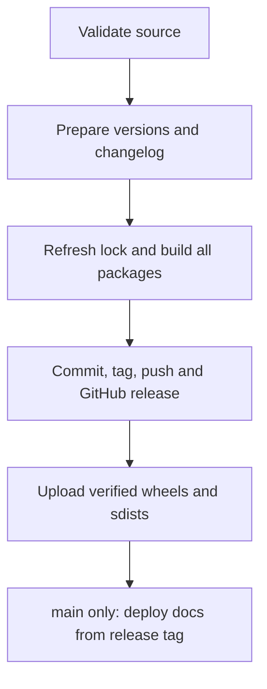

# 5. Release

Publish verified Python packages and documentation through the same Make targets locally and in CI.

## Release sequence

1. Run `make test-all` and `make pre-commit` against the source commit.
2. `make release-version` checks the branch, clean tree, origin and credentials.
3. Semantic-release updates versions and the changelog, then runs its build hook:
   `uv lock && git add uv.lock && make build-package`.
4. Only after every package has a wheel and sdist does semantic-release commit, tag, push
   and create the GitHub release.
5. `make release-assets` uploads the complete artifact set. On `main`, CI deploys documentation
   from the exact release tag.

## Versions and artifacts

| Branch | Commit                                                           | Result                                   |
|--------|------------------------------------------------------------------|------------------------------------------|
| `dev`  | `feat`, `fix`, `perf`                                            | release candidate, such as `v2.0.1-rc.1` |
| `main` | `feat`, `fix`, `perf`                                            | stable release and documentation         |
| either | `feat!` or `BREAKING CHANGE`                                     | next major version                       |
| either | only `docs`, `chore`, `ci`, `style`, `refactor`, `build`, `test` | no new release                           |

Versions, tags and `CHANGELOG.md` belong to semantic-release. All workspace package versions
must equal the root version.

`scripts/release_artifacts.py` keeps the Git tag `v2.0.1-rc.1` separate from the normalized
Python filename version `2.0.1rc1`. It requires exactly one wheel and one sdist per package
listed in `PACKAGE_PROJECTS` in `makefiles/common.mk`.

## By hand

1. Install dependencies with `make install-dev`; a release-only environment can use
   `make install-release`.
2. Run `gh auth login` once.
3. Check out a clean, up-to-date `main` or `dev`.
4. Run `make release` after software validation.
5. For a stable release, run `make deploy-doc-gh` with docs dependencies already installed
   (`make install-dev` or `make install-tools`).

`make release` stops when there is no new release and HEAD is not already tagged.
It reuses verified artifacts built by semantic-release, or builds missing artifacts before
uploading. Build and upload remain sequential under parallel Make.

### Guards

| Check                                       | Behavior                                               |
|---------------------------------------------|--------------------------------------------------------|
| branch is `main` or `dev`                   | other branches are refused                             |
| working tree is clean                       | commit or stash changes first                          |
| HEAD equals fetched `origin/<branch>`       | divergent or stale checkouts are refused               |
| CI checkout matches the tested `GITHUB_SHA` | newer application commits require their own validation |
| token is available                          | use the credential order below                         |
| lock refresh and package build succeed      | any failure stops publication                          |

The generated release commit is `chore(release): v<version> [skip ci]`.
Git hooks are disabled only for that semantic-release call, so hooks cannot rewrite the
changelog during publication.

### Credentials

| Order | Source                               |
|-------|--------------------------------------|
| 1     | `GH_TOKEN` in the shell or `.env`    |
| 2     | the existing `gh auth login` session |
| 3     | hidden terminal prompt               |

`make release-assets` uses `GH_TOKEN` or the existing `gh` login.
CI passes its automatic GitHub token. Never print a credential.

## Retry an interrupted release

1. Retry the failed release job. When the release tag already points at HEAD, CI rebuilds
   packages and retries upload without creating another version.
2. A CI retry accepts the generated release commit only when its tag, subject and direct
   parent identify the release of the tested source commit; only version metadata may differ.
3. If another application commit has advanced the branch, let that commit's workflow
   validate and release it.
4. Locally, use `make release` on the matching clean release branch, or
   `make build-package && make release-assets` at the exact release commit.

## GitHub Actions

| Workflow                  | Trigger                                     | Work                                            |
|---------------------------|---------------------------------------------|-------------------------------------------------|
| `ci.yml`                  | feature pushes and pull requests            | PR title, static checks and software validation |
| `release.yml`             | push to `main` or `dev`, or manual dispatch | validation, guarded release and artifact upload |
| docs job in `release.yml` | successful tagged `main` release            | deploy documentation from the release tag       |

CI provisions a pinned, cached uv. Project dependencies still install through Make:
`install-tools` for quality/docs jobs, `install-release` for publishing and `install-dev`
for software tests. CI requires the lockfile to match the manifests.

## Repository settings

1. Settings → Actions → General: enable the workflow permissions needed to write releases.
2. Settings → Pages: deploy from the `gh-pages` branch. Create it with the first
   `make deploy-doc-gh`.
3. Enable squash merging so pull request titles follow the
   [commit convention](3.conventions.md#commit-convention).
4. After a stable release, merge `main` into `dev` and resolve version/changelog conflicts
   using the stable release as the base for the next candidate.
