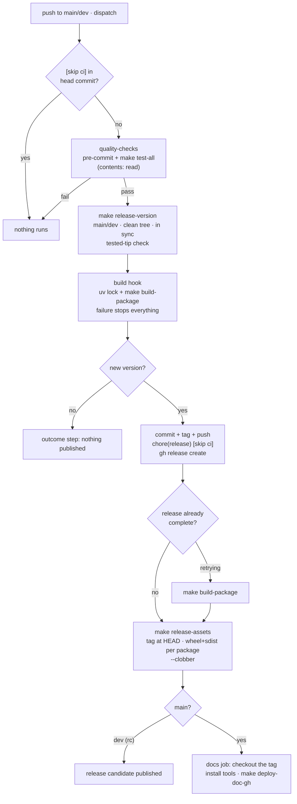

# 5. Release

Publish the backend and frontend packages to a GitHub Release (one wheel and one sdist each, never a
package index) and the documentation to GitHub Pages.

## Contents

- [Before you start](#before-you-start)
- [What a release does](#what-a-release-does)
- [Automatic release (CI)](#automatic-release-ci)
- [Manual release (local)](#manual-release-local)
- [Recover an interrupted release](#recover-an-interrupted-release)
- [Verify the release](#verify-the-release)
- [Fix a bad release](#fix-a-bad-release)
- [After a release: sync main into dev](#after-a-release-sync-main-into-dev)

## Before you start

Once, in the repository settings:

- Actions → General → Workflow permissions: **Read and write**. The workflow declares `permissions: {}`
  and grants `contents: read` to the checks, `contents: write` to the release and docs jobs.
- Pages → Deploy from a branch → `gh-pages`.
- Squash merging enabled, so the PR title decides the version
  ([commit convention](3.conventions.md#commit-convention)).

Locally, install the tooling and log in:

```bash
make install-dev
gh auth login
```

Credentials resolve from `GH_TOKEN` (environment or local `.env`), then the token saved by
`gh auth login`, then a hidden terminal prompt; `release-assets` uses the token or gh login, and CI
supplies its automatic token. Never print credentials. A tooling-only environment can use
`make install-release`; docs need `make install-tools` or `make install-dev`.

## What a release does

1. **Validate** the source: `main` or `dev`, clean tree, HEAD equal to the fetched origin tip, and in
   CI HEAD equal to the tested `GITHUB_SHA`.
2. **Version** with semantic-release from Conventional Commits. Its build hook builds and checks every
   package before anything is committed, tagged or published.
3. **Commit, tag and push** `chore(release): v<version> [skip ci]`.
4. **Upload** the wheel and sdist of every package to the GitHub Release.
5. **Deploy docs** from the release tag, on a stable `main` release only.

Never edit a version, the changelog or a tag by hand. All workspace package versions equal the root
version; tags keep `vX.Y.Z-rc.N` spelling, Python artifact names use `X.Y.ZrcN`.



## Automatic release (CI)

`release.yml` runs on every push to `main` or `dev`, and on manual dispatch:

| Branch | Result                                             |
|--------|----------------------------------------------------|
| `dev`  | release candidate `vX.Y.Z-rc.N`, marked prerelease |
| `main` | stable `vX.Y.Z`, and docs deployed from that tag   |

`quality-checks` is the gate (`quality-and-tests.yml`: pre-commit, then `make test-all`); if it fails
or is skipped, nothing is versioned or published. The release commit carries `[skip ci]`, so its own
push does not re-run the gate. A retry accepts that exact single-parent `chore(release)` child of the
tested commit and rejects any newer application change.

Docs-only commits bump no version, so they publish nothing.

## Manual release (local)

Complete [setup](1.setup.md) and [Before you start](#before-you-start), then run:

```bash
make check
make release
```

The release command versions, builds and uploads the full wheel/sdist set. It changes Git and GitHub;
coding agents need explicit per-action approval. Local publication also asks you to type `yes`.

`make release-status` reports branch, tree, origin sync, tag and GitHub release without changing
anything; run it when a release refuses. The guard requires branch `main`/`dev`, a clean tree and HEAD
equal to `origin/<branch>`:

- **Dirty tree** from hook fixes or a stale lock: commit it first, as `chore(...)`. A `fix:`/`feat:`
  commit becomes part of the release and bumps the version.
- **Not in sync:** `git pull --rebase` when behind, `git push` when ahead.
- **Wrong branch:** release from `main` (stable) or `dev` (candidate) only.

For a stable manual release, publish docs separately from the clean released tag:

```bash
make deploy-doc-gh
```

That command pushes `gh-pages` and requires separate authorization.

## Recover an interrupted release

Each stage is re-runnable and stops before publishing on a bad precondition: a failed build hook
(`uv lock && git add uv.lock && make build-package`) stops everything before any commit, tag or upload,
and `make release-assets` refuses when the tag is not at HEAD or a package has no wheel/sdist pair.

Pick the smallest retry that matches the state:

- **CI:** rerun the failed job while its tested source still matches the release.
- **Same branch, locally:** `make release` stops without uploading when nothing is left to publish.
- **From a clean checkout of the exact tag:** `make build-package`, then `make release-assets`.
- **Newer application commits exist:** let their own workflow release them. Never rebuild an older
  release from later source.
- `release-assets` can create a missing GitHub release and replaces same-named attachments
  (`--clobber`); it does not publish to a package index.

## Verify the release

- `gh release view vX.Y.Z --json assets,isDraft` lists one wheel and one sdist per package, with
  `isDraft: false`.
- Stable only: `gh-pages` has a new commit and the site shows the new version.

## Fix a bad release

- Fix forward: revert on `main` and let the next patch release carry the fix.
- Do not move, delete or re-create a published tag: both asset targets require the tag to point at the
  checkout being published, and artifact names derive from the version.

## After a release: sync main into dev

Merge `main` back into `dev` after a stable release. Use the stable version and changelog as the base
for the next candidate; see [branch conventions](3.conventions.md#branches-and-pull-requests).
